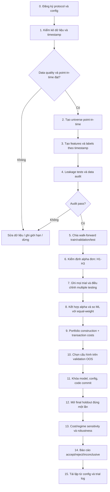

# Research Protocol: US Equity Alpha Mining & Combination

**Trạng thái:** Bản đề xuất để chốt trước khi chạy nghiên cứu  
**Mục tiêu:** Tạo một pipeline có thể tái lập để phát hiện, kiểm định, kết hợp alpha trên cổ phiếu Mỹ và đánh giá hiệu quả ngoài mẫu sau chi phí, đồng thời kiểm soát data leakage, survivorship bias và overfitting.

> **Nguyên tắc:** Không được thay đổi tiêu chí chấp nhận sau khi xem kết quả tập kiểm tra cuối cùng. Mọi thay đổi sau đó tạo thành phiên bản nghiên cứu mới và phải được ghi vào trial log.

## 1. Phạm vi và định nghĩa thành công

### 1.1 Phạm vi kế thừa từ bản mô tả tổng quan

- Thị trường: cổ phiếu Mỹ; dữ liệu daily.
- Universe mục tiêu: 500–1.000 cổ phiếu, theo khả năng dữ liệu.
- Benchmark ưu tiên: S&P 500 Total Return; nếu không có dữ liệu phù hợp, dùng benchmark thay thế và ghi rõ hạn chế.
- Signal được tính sau khi phiên giao dịch kết thúc; thời điểm thực thi sớm nhất là phiên kế tiếp.
- Prediction horizons: 1, 5 và 21 phiên.
- Các nhóm kiểm định ban đầu: momentum, short-term reversal, liquidity, alpha combination, ML combination so với equal-weight, portfolio optimization sau chi phí.
- Kiểm soát dự kiến: sector/beta neutralization, walk-forward, purging và ghi nhận mọi trial.

### 1.2 Định nghĩa thành công tổng thể

Dự án được xem là **đạt mục tiêu nghiên cứu** khi đồng thời:

1. **Tính hợp lệ dữ liệu:** không phát hiện look-ahead leakage trong các kiểm tra tự động; universe và corporate actions được xử lý nhất quán; survivorship bias được kiểm soát bằng dữ liệu point-in-time hoặc giới hạn được công bố rõ.
2. **Tính hợp lệ thực nghiệm:** toàn bộ thử nghiệm được ghi nhận; phân chia thời gian, purging/embargo và quy tắc chọn mô hình được cố định trước khi đánh giá holdout cuối.
3. **Có bằng chứng alpha ngoài mẫu:** ít nhất một alpha hoặc tổ hợp alpha vượt các tiêu chí OOS đã đăng ký trước, không chỉ có kết quả tốt trong-sample.
4. **Có khả năng thực thi:** kết quả chiến lược cuối được tính sau transaction costs và có báo cáo turnover, drawdown, exposure và độ nhạy chi phí.
5. **Có thể tái lập:** người khác chạy cùng dữ liệu, cấu hình, seed và phiên bản code sẽ tái tạo được các bảng/chỉ số trong dung sai số học đã quy định.
6. **Báo cáo trung thực:** giả thuyết không đạt cũng được báo cáo; không chỉ công bố trial tốt nhất.

Nếu không alpha nào vượt ngưỡng, dự án vẫn hoàn thành về mặt kỹ thuật nếu pipeline chạy được và kết luận “chưa tìm thấy bằng chứng đủ mạnh trong phạm vi đã thử” được hỗ trợ bởi kiểm định hợp lệ. Không được gọi trường hợp đó là alpha thành công.

## 2. Các quyết định phải khóa trước khi chạy

Các giá trị dưới đây là **đề xuất mặc định**, cần được chốt trong `configs/research.yaml` trước khi bắt đầu formal experiments.

| Quyết định | Mặc định đề xuất | Lý do / quy tắc |
|---|---|---|
| Universe | Point-in-time US common stocks; mục tiêu 500–1.000 mã | Bao gồm cổ phiếu bị delist nếu nguồn dữ liệu hỗ trợ; tránh chỉ dùng thành phần hiện tại |
| Giá/return | Adjusted data cho corporate actions; execution price theo quy tắc riêng | Không dùng giá tương lai để tạo signal |
| Signal timestamp | Sau close ngày t | Signal ngày t không được khớp trước phiên t+1 |
| Execution | Open t+1 mặc định; VWAP t+1 chỉ khi có dữ liệu đáng tin cậy và được đăng ký trước | Tránh giả định khớp tại giá close đã dùng tạo signal |
| Prediction horizons | 1, 5, 21 phiên | Đánh giá riêng từng horizon; không chọn horizon tốt nhất rồi giả vờ đó là giả thuyết ban đầu |
| Portfolio holding/rebalance | Giữ 5 phiên, tái cân bằng mỗi ngày theo quy tắc portfolio; hoặc cấu hình khác phải được chốt trước | Cần tránh chồng lấn/đếm trùng return không rõ ràng |
| Cost model | Commission/fees + spread/slippage + market impact nếu ước lượng được | Báo cáo gross và net riêng |
| Neutralization | Sector và beta; định nghĩa beta/lookback phải cố định | Áp dụng nhất quán cho signal được chỉ định |
| Final holdout | 20% cuối chuỗi thời gian, chỉ mở một lần sau model selection | Không dùng để chọn alpha/hyperparameter |
| Statistical significance | Block bootstrap hoặc HAC/Newey–West phù hợp với chuỗi return; điều chỉnh multiple testing cho nhóm alpha | Return và horizon có thể tự tương quan |
| Benchmark | S&P 500 Total Return nếu khả dụng | Nếu thay thế, nêu rõ chỉ số và lý do |
| Reproducibility | Lưu config snapshot, data version, code commit, seed, trial ID | Mỗi kết quả gắn với một cấu hình cụ thể |

**Lưu ý:** Prediction horizon không tự động đồng nghĩa với holding period. Hai khái niệm phải được cấu hình riêng.

## 3. Danh sách giả thuyết và tiêu chí chấp nhận/bác bỏ

### Quy ước chung

- **IS:** in-sample; **OOS:** out-of-sample; **WF:** walk-forward.
- **RankIC:** Spearman correlation giữa score/signal tại t và forward return tương ứng.
- **ICIR:** trung bình IC chia độ lệch chuẩn IC theo thời gian; cần thống nhất cách annualize.
- **Quantile spread:** lợi suất nhóm signal cao nhất trừ nhóm thấp nhất, theo quy tắc portfolio đã định.
- Các ngưỡng dưới đây là ngưỡng khởi tạo để đăng ký trước, không phải giá trị bảo đảm khả năng sinh lời.
- Kiểm định cross-sectional phải xử lý ngày có ít mã hợp lệ; chỉ tính khi số quan sát vượt ngưỡng tối thiểu.
- Mọi kết luận phải báo cáo theo horizon 1/5/21 phiên và theo các WF folds; không chỉ báo cáo kết quả gộp.

### H1 — Momentum có sức dự báo lợi suất tương đối

**Phát biểu:** Cổ phiếu có momentum quá khứ cao có xu hướng đạt forward return tương đối cao hơn.

- **Null H0:** RankIC trung bình OOS không dương hoặc quantile spread không dương.
- **Primary metric:** mean RankIC OOS cho horizon được đăng ký trước; long-short quantile spread sau chi phí là metric xác nhận.
- **Đề xuất chấp nhận:** mean RankIC OOS ≥ 0.02; lower bound của CI 95% > 0; quantile spread OOS gross > 0; kết quả có cùng dấu trong ít nhất 70% WF folds.
- **Điều kiện thực thi bổ sung:** nếu đưa vào portfolio, net return sau chi phí phải dương; không có một fold duy nhất đóng góp quá 50% tổng PnL OOS.
- **Bác bỏ:** mean RankIC ≤ 0 hoặc CI bao gồm 0 và quantile spread không dương ở các horizon đã đăng ký.
- **Chưa đủ bằng chứng:** dấu dương nhưng CI rộng, số folds hiệu dụng thấp hoặc kết quả nhạy với một giai đoạn thị trường.
- **Phân tích phụ:** lookback momentum, bỏ qua tháng gần nhất, neutralization theo sector/beta. Mọi biến thể phải là trial riêng.

### H2 — Biến động giá ngắn hạn dự báo reversal

**Phát biểu:** Sau một biến động giá ngắn hạn lớn, lợi suất tương lai có xu hướng đảo chiều.

- **Null H0:** IC của tín hiệu reversal không dương.
- **Primary metric:** mean RankIC OOS của reversal score; xác nhận bằng quantile spread.
- **Đề xuất chấp nhận:** mean RankIC OOS ≥ 0.02 theo hướng reversal, CI 95% không cắt 0 và dấu phù hợp trong ít nhất 70% WF folds.
- **Bác bỏ:** IC có dấu ngược dự đoán hoặc kết quả mất đi hoàn toàn khi tính spread/slippage hợp lý.
- **Chưa đủ bằng chứng:** hiệu quả chỉ xuất hiện ở horizon 1 nhưng không bền theo folds, hoặc chỉ tồn tại trước chi phí.
- **Kiểm tra bắt buộc:** tách các ngày biến động cao/thấp; kiểm tra chi phí và turnover vì reversal có thể giao dịch dày.

### H3 — Thanh khoản ảnh hưởng đến khả năng khai thác alpha

**Phát biểu:** Thanh khoản ảnh hưởng đến turnover, chi phí và mức alpha còn lại sau thực thi; nhóm thanh khoản thấp có thể có gross alpha nhưng khó khai thác sau chi phí.

- **Null H0:** không có khác biệt có ý nghĩa thực tiễn giữa các nhóm thanh khoản về chi phí/alpha net.
- **Primary metrics:** turnover, estimated cost bps, gross return, net return theo liquidity bucket.
- **Đề xuất chấp nhận:** mô hình chi phí có kiểm định hợp lý; net performance giảm theo chi phí tăng một cách giải thích được; lựa chọn liquidity filter/cap cải thiện net Sharpe hoặc net return mà không làm turnover/exposure vi phạm giới hạn đã định.
- **Ngưỡng định lượng cần khóa:** tối thiểu dollar-volume, participation cap, cost bps theo bucket và giới hạn tỷ trọng mỗi mã phải được khai báo trong config trước formal run.
- **Bác bỏ:** kết luận về liquidity biến mất khi dùng cost model độc lập/khả tín hơn, hoặc cải thiện net chỉ đến từ một thay đổi không đăng ký trước.
- **Chưa đủ bằng chứng:** không có spread/volume/market-impact data đủ tin cậy để ước lượng chi phí.

### H4 — Kết hợp các alpha ít tương quan cải thiện hiệu quả OOS

**Phát biểu:** Kết hợp các alpha có tín hiệu bổ sung cho nhau có thể cải thiện hiệu quả/rủi ro so với từng alpha đơn lẻ.

- **Baseline:** alpha đơn tốt nhất được chọn chỉ trên validation WF; equal-weight combination của cùng tập alpha.
- **Primary metrics:** OOS Sharpe net, max drawdown, turnover; secondary: return, volatility, cross-alpha correlation.
- **Đề xuất chấp nhận:** OOS Sharpe net tăng ít nhất 0.20 so với baseline được đăng ký trước **hoặc** max drawdown giảm ít nhất 10% tương đối mà OOS Sharpe net không giảm quá 0.10; cải thiện không chỉ xuất hiện trong một fold.
- **Điều kiện bổ sung:** tương quan được đo trên signal/return cùng timestamp và cùng universe; không chọn cặp alpha chỉ dựa trên correlation ước lượng ở final holdout.
- **Bác bỏ:** không cải thiện so với baseline, lợi ích biến mất sau chi phí, hoặc hiệu quả chỉ do exposure/sector tilt không kiểm soát.
- **Chưa đủ bằng chứng:** số alpha độc lập quá ít hoặc tương quan không ổn định qua các fold.

### H5 — ML kết hợp alpha tốt hơn equal-weight

**Phát biểu:** Mô hình ML dùng thông tin alpha có thể kết hợp tín hiệu tốt hơn equal-weight combination.

- **Baseline:** equal-weight trên đúng tập alpha/features, cùng universe, dates, costs, portfolio construction và WF splits.
- **Primary comparison:** paired difference giữa net Sharpe OOS của ML và equal-weight trên từng fold; thêm net return, drawdown, turnover.
- **Đề xuất chấp nhận:** mean paired improvement của net Sharpe ≥ 0.20; cải thiện dương trong ít nhất 70% WF folds; sau điều chỉnh multiple testing, bằng chứng thống kê không bị bác bỏ; không vi phạm giới hạn turnover/exposure.
- **Bác bỏ:** ML không vượt baseline trên OOS, cải thiện không bền hoặc mất đi sau chi phí.
- **Chưa đủ bằng chứng:** số folds hiệu dụng thấp, model selection quá lớn so với dữ liệu hoặc chỉ có một lần holdout không đủ để ước lượng độ ổn định.
- **Quy tắc:** hyperparameters chỉ chọn trong training/validation; không tuning trên final holdout.

### H6 — Tối ưu danh mục sau chi phí cải thiện thực thi

**Phát biểu:** Portfolio construction có tính đến rủi ro, turnover và transaction costs có thể cải thiện kết quả net so với baseline đơn giản.

- **Baseline:** quy tắc portfolio cố định, chẳng hạn rank-based top/bottom quantiles hoặc equal-weight, được chốt trước.
- **Primary metrics:** net Sharpe, net return, turnover, max drawdown, cost bps và constraint violations.
- **Đề xuất chấp nhận:** net Sharpe OOS tăng ≥ 0.20 so với baseline hoặc net return tăng có ý nghĩa thực tiễn mà max drawdown không tăng quá 10% tương đối; không vi phạm ràng buộc cứng.
- **Ràng buộc cứng đề xuất:** gross/net exposure, max weight per name, sector deviation, beta deviation, liquidity participation và turnover limit phải có giá trị cụ thể trong config.
- **Bác bỏ:** cải thiện chỉ có ở gross metrics, vi phạm ràng buộc, hoặc kết quả phụ thuộc vào ước lượng covariance/chi phí không ổn định.
- **Chưa đủ bằng chứng:** input risk/cost model không đủ tin cậy hoặc không thể tái lập portfolio weights.

### H7 — Pipeline không dựa vào leakage/survivorship bias

**Phát biểu:** Kết quả alpha không phải sản phẩm của việc dùng thông tin tương lai hoặc universe chỉ gồm cổ phiếu sống sót.

- **Kiểm định:** audit timestamp; test signal shift; kiểm tra delisted names; point-in-time universe; corporate actions; label overlap; train/test isolation.
- **Chấp nhận:** toàn bộ kiểm tra bắt buộc pass; mọi giới hạn dữ liệu được ghi trong báo cáo.
- **Bác bỏ / dừng nghiên cứu:** phát hiện feature sử dụng dữ liệu sau timestamp, universe tương lai rò rỉ vào quá khứ, hoặc label/normalization fit trên test data.
- **Chưa đủ bằng chứng:** dữ liệu không có delisted securities hoặc point-in-time constituents; khi đó không được tuyên bố đã loại bỏ survivorship bias, chỉ được nêu rõ giới hạn.

### H8 — Kết quả bền vững trước thay đổi giả định hợp lý

**Phát biểu:** Kết quả OOS không hoàn toàn phụ thuộc vào một cấu hình chi phí, một thời kỳ hoặc một lựa chọn tham số đơn lẻ.

- **Kiểm định:** cost stress (base, 1.5×, 2×); subperiods/regimes; parameter neighborhood; leave-one-fold-out.
- **Đề xuất chấp nhận:** chiến lược không âm net expectancy trong base-cost OOS; ở 1.5× cost, kết quả suy giảm nhưng không sụp đổ hoàn toàn; dấu cải thiện so với baseline còn đúng trong ≥70% folds.
- **Bác bỏ:** một thay đổi nhỏ, hợp lý làm đảo ngược hoàn toàn kết luận; hoặc chỉ một fold tạo phần lớn lợi nhuận.
- **Chưa đủ bằng chứng:** OOS quá ngắn hoặc không đủ số regime khác nhau.

## 4. Quy trình nghiên cứu



### 4.1 Các giai đoạn và điều kiện qua cổng

| Giai đoạn | Đầu vào | Công việc | Điều kiện qua cổng |
|---|---|---|---|
| 0. Protocol | Câu hỏi nghiên cứu | Khóa giả thuyết, metric, threshold, split, baseline | Config được version-control; không để threshold trống |
| 1. Data audit | Giá, volume, fundamentals nếu có, corporate actions | Kiểm tra thiếu, duplicate, timestamp, adjusted/unadjusted fields | Báo cáo data quality; lỗi nghiêm trọng được sửa hoặc dự án dừng |
| 2. Universe | Danh sách mã theo ngày | Xây universe point-in-time; xử lý delisted | Có chính sách universe rõ; hạn chế survivorship được công bố |
| 3. Features/labels | Data đã audit | Tạo features chỉ từ thông tin khả dụng tại t; labels forward 1/5/21 phiên | Feature timestamp < hoặc = signal timestamp; label không lọt vào feature |
| 4. Leakage audit | Dataset features/labels | Shift test, split isolation, scaler fit train-only, overlap/purge | Tất cả test bắt buộc pass |
| 5. WF evaluation | Dataset đã khóa | Rolling/expanding train, validation, test theo thời gian | Không shuffle ngẫu nhiên theo hàng thời gian |
| 6. Single alpha | Alpha đã định nghĩa trước | RankIC, quantile spread, fold stability | Tất cả metrics và trial đều được ghi |
| 7. Multiple testing | Trial registry | Điều chỉnh p-values hoặc dùng phương pháp phù hợp với số trial | Kết luận có xét số lượng thử nghiệm |
| 8. Combination/ML | Alpha được giữ lại | Equal-weight, ML, ablation | Cùng folds, features availability và baseline |
| 9. Portfolio/cost | Scores dự báo | Weights, constraints, turnover, costs | Báo cáo gross/net và constraint violations |
| 10. Model selection | Validation folds | Chọn theo metric primary đăng ký trước | Không dùng final holdout để chọn |
| 11. Freeze | Model/config/code | Ghi commit, config hash, data version, trial ID | Artifact được khóa |
| 12. Final holdout | Holdout chưa mở | Chạy một lần theo config đã khóa | Không tuning sau khi xem kết quả |
| 13. Robustness | Kết quả final | Stress cost, subperiod, parameter neighborhood | Nêu rõ mức độ bền và giới hạn |
| 14. Report | Toàn bộ artifacts | Accept/reject/inconclusive cho từng H | Báo cáo mọi H, kể cả kết quả âm |
| 15. Reproduction | Repo, data version, config | Chạy lại pipeline | Metric khớp trong dung sai đã khai báo |

## 5. Thiết kế temporal validation

### 5.1 Quy tắc chia dữ liệu

- Không dùng random split cho các mẫu time-series.
- Dùng expanding-window hoặc rolling-window walk-forward; chọn một cách và ghi trong config.
- Validation được dùng để chọn alpha/model/hyperparameters.
- Final holdout là đoạn thời gian cuối, chỉ đánh giá sau khi model và config đã đóng băng.
- Các label forward horizon chồng lấn phải được xử lý bằng purging; embargo thêm nếu cần để tránh rò rỉ gần ranh giới.
- Scaler, imputer, feature selection, winsorization thresholds, PCA và mọi preprocessing học từ dữ liệu phải fit trên training fold rồi áp dụng sang validation/test.
- Nếu target horizon là 21 phiên, không được để label của training chứa return quan sát vượt qua mốc bắt đầu validation/test.

### 5.2 Mẫu lịch split minh họa

Lịch dưới đây là **minh họa**, không phải mốc lịch cố định. Chọn ngày thực tế dựa trên dữ liệu có sẵn và ghi vào config trước khi chạy.

| Fold | Train | Validation | Test |
|---|---|---|---|
| WF-1 | 2010–2015 | 2016 | 2017 |
| WF-2 | 2010–2016 | 2017 | 2018 |
| WF-3 | 2010–2017 | 2018 | 2019 |
| WF-4 | 2010–2018 | 2019 | 2020 |
| WF-5 | 2010–2019 | 2020 | 2021 |
| Final holdout | Theo protocol đã khóa | Không tuning | 20% cuối, mở một lần |

Điều chỉnh các năm cho phù hợp dữ liệu thực tế. Nếu có ít lịch sử, phải giảm độ phức tạp và công bố giới hạn; không được giả định 5 folds luôn khả thi.

### 5.3 Purging và embargo

Với label horizon `h`, loại khỏi train mọi sample mà khoảng thời gian label của nó giao với validation/test. `embargo_days` là khoảng cách bổ sung sau ranh giới split; giá trị cần dựa trên horizon và lịch tái cân bằng. Không chỉ đặt `purging: true` mà không kiểm tra implementation.

## 6. Config chuẩn: `configs/research.yaml`

YAML bên dưới là cấu hình mẫu có chủ ý tách **data**, **universe**, **labels**, **validation**, **hypotheses**, **portfolio**, **costs**, **statistics**, **trials** và **acceptance criteria**. Trước khi formal run, thay các trường `CHANGE_ME` và khóa commit.

```yaml
# Research protocol cho US equity alpha mining.
# Mọi thay đổi làm sau khi xem kết quả phải tạo research_version/trial mới.

project:
  name: us_equity_alpha_mining
  research_version: "0.1.0"
  status: "design"
  timezone: "America/New_York"
  random_seed: 42
  output_dir: "artifacts/research"
  require_clean_git: true
  code_commit: "CHANGE_ME_BEFORE_FORMAL_RUN"

market:
  region: "US"
  asset_class: "common_equity"
  frequency: "daily"
  currency: "USD"
  signal_timing: "after_close"
  earliest_execution: "next_session"
  execution_price: "next_open"  # next_open | next_day_vwap
  benchmark:
    primary: "SP500_TOTAL_RETURN"
    fallback: null  # Điền benchmark cụ thể nếu primary unavailable
    fallback_limitation_note: null

data:
  provider: "CHANGE_ME"
  dataset_version: "CHANGE_ME"
  start_date: "2010-01-01"
  end_date: "CHANGE_ME"
  price_field_for_features: "adjusted_ohlcv"
  execution_price_field: "open"
  require_volume: true
  require_corporate_actions: true
  require_delisted_securities: true
  require_point_in_time_universe: true
  missing_data:
    max_missing_fraction_per_symbol: 0.05
    max_missing_fraction_per_feature: 0.10
    do_not_forward_fill_prices: true
    record_exclusion_reasons: true
  quality_checks:
    duplicate_symbol_date: "fail"
    non_positive_price: "fail"
    impossible_volume: "flag_and_review"
    timestamp_leakage: "fail"
    corporate_action_consistency: "fail"

universe:
  construction: "point_in_time"
  target_size: 1000
  minimum_size_per_date: 500
  security_types: ["common_stock"]
  include_delisted: true
  liquidity_filter:
    enabled: true
    measure: "trailing_20d_median_dollar_volume"
    minimum_usd: "CHANGE_ME"
    lookback_sessions: 20
    use_only_information_available_at_signal_time: true
  exclusions:
    etfs: true
    preferred_shares: true
    warrants: true
    otc: true
  membership_timestamp: "as_of_signal_date"

features:
  availability_cutoff: "signal_timestamp"
  winsorization:
    enabled: true
    method: "cross_sectional_quantile"
    lower_quantile: 0.01
    upper_quantile: 0.99
    fit_scope: "per_date_cross_section"
  standardization:
    method: "cross_sectional_zscore"
    fit_scope: "per_date_cross_section"
  neutralization:
    enabled: true
    dimensions: ["sector", "beta"]
    sector_source: "point_in_time_sector"
    beta:
      benchmark: "SP500_TOTAL_RETURN"
      lookback_sessions: 252
      min_observations: 126
      estimation_cutoff: "signal_timestamp"
  prevent_future_data: true

labels:
  horizons_sessions: [1, 5, 21]
  return_type: "forward_simple_return"
  start_price: "execution_price"
  execution_lag_sessions: 1
  end_price_rule: "close_after_horizon"
  overlapping_labels: true
  label_interval_purging: true

validation:
  method: "walk_forward"
  window_type: "expanding"  # expanding | rolling
  train_min_years: 5
  validation_years: 1
  test_years: 1
  final_holdout_fraction: 0.20
  final_holdout_open_count: 1
  shuffle: false
  purge_overlapping_labels: true
  embargo_sessions: 21
  preprocessing_fit_scope: "train_only"
  final_holdout_used_for_tuning: false
  split_dates: "GENERATE_AND_FREEZE_BEFORE_FORMAL_RUN"

hypotheses:
  active: ["H1", "H2", "H3", "H4", "H5", "H6", "H7", "H8"]
  primary_horizon_sessions: 5
  secondary_horizons_sessions: [1, 21]
  H1_momentum:
    enabled: true
    primary_metric: "mean_oos_rank_ic"
    minimum_mean_rank_ic: 0.02
    confidence_level: 0.95
    min_positive_fold_fraction: 0.70
  H2_short_term_reversal:
    enabled: true
    primary_metric: "mean_oos_rank_ic_in_reversal_direction"
    minimum_mean_rank_ic: 0.02
    confidence_level: 0.95
    min_positive_fold_fraction: 0.70
  H3_liquidity:
    enabled: true
    primary_metrics: ["net_return", "turnover", "estimated_cost_bps"]
    cost_buckets: "CHANGE_ME"
    participation_rate_cap: "CHANGE_ME"
  H4_alpha_combination:
    enabled: true
    baseline: "best_single_alpha_selected_on_validation"
    minimum_net_sharpe_improvement: 0.20
    alternative_relative_drawdown_reduction: 0.10
    maximum_allowed_sharpe_degradation_for_drawdown_route: 0.10
  H5_ml_vs_equal_weight:
    enabled: true
    baseline: "equal_weight_same_alpha_inputs"
    minimum_net_sharpe_improvement: 0.20
    min_positive_fold_fraction: 0.70
  H6_portfolio_optimization:
    enabled: true
    baseline: "pre_registered_rank_based_portfolio"
    minimum_net_sharpe_improvement: 0.20
    max_relative_drawdown_increase: 0.10
  H7_data_integrity:
    enabled: true
    fail_on_any_critical_leakage: true
    fail_on_unknown_universe_membership: true
  H8_robustness:
    enabled: true
    cost_multipliers: [1.0, 1.5, 2.0]
    min_positive_fold_fraction: 0.70
    max_single_fold_share_of_oos_pnl: 0.50

portfolio:
  holding_period_sessions: 5
  rebalance_frequency: "daily"
  construction_baseline: "top_bottom_quantile_equal_weight"
  long_quantile: 0.20
  short_quantile: 0.20
  allow_short: true
  weighting_method: "equal_weight"
  constraints:
    gross_exposure_max: "CHANGE_ME"
    net_exposure_target: 0.0
    max_abs_weight_per_symbol: "CHANGE_ME"
    max_sector_deviation: "CHANGE_ME"
    max_abs_beta: "CHANGE_ME"
    max_turnover_per_rebalance: "CHANGE_ME"
    max_adv_participation: "CHANGE_ME"
  rebalance_timing: "next_session"
  report_gross_and_net_metrics: true

costs:
  model: "commission_plus_spread_plus_slippage"
  commission_bps_per_side: "CHANGE_ME"
  spread_bps_round_trip_by_liquidity_bucket: "CHANGE_ME"
  slippage_bps_round_trip_by_liquidity_bucket: "CHANGE_ME"
  market_impact_model: null
  stress_multipliers: [1.0, 1.5, 2.0]
  report_cost_assumptions: true

statistics:
  primary_confidence_level: 0.95
  inference_method: "block_bootstrap_or_hac"
  bootstrap:
    enabled: true
    block_length_sessions: 21
    repetitions: 5000
    seed: 42
  multiple_testing:
    enabled: true
    method: "holm"  # Holm cho family of confirmatory hypotheses; log cả raw/adjusted p-values
    family_definition: "pre_registered_hypothesis_and_primary_horizon"
  minimum_effective_wf_folds: 4
  report_confidence_intervals: true
  report_effect_sizes: true

trial_tracking:
  enabled: true
  log_all_trials: true
  include_failed_trials: true
  record:
    - trial_id
    - timestamp
    - hypothesis_id
    - feature_definition
    - parameter_values
    - data_version
    - config_hash
    - code_commit
    - random_seed
    - split_ids
    - primary_metrics
    - secondary_metrics
    - raw_p_values
    - adjusted_p_values
    - decision
    - failure_reason
  forbid_unlogged_manual_experiments: true

acceptance:
  no_critical_leakage: true
  all_trials_logged: true
  final_holdout_open_count_max: 1
  require_net_metrics: true
  require_cost_stress_test: true
  require_fold_level_metrics: true
  require_negative_results_reported: true
  reproducibility_metric_tolerance: 1.0e-8
```

### 6.1 Các trường bắt buộc phải thay trước formal run

Không bắt đầu formal experiment khi còn `CHANGE_ME` hoặc giá trị `null` cần thiết để tính toán. Tối thiểu cần chốt:

1. Nguồn dữ liệu, dataset version và end date.
2. Quy tắc point-in-time universe và cách xử lý delisted securities.
3. Ngưỡng dollar-volume, participation cap và giới hạn portfolio.
4. Chi phí commission, spread, slippage và đơn vị đo (per side hay round trip).
5. Ngày chia WF splits, embargo và final holdout.
6. Benchmark chính xác hoặc benchmark thay thế cùng ghi chú hạn chế.
7. Commit code và snapshot config.

Nếu không thể có point-in-time/delisted data, đổi `require_*` thành trạng thái phản ánh đúng dữ liệu thực tế và nêu rõ dự án **không thể loại bỏ hoàn toàn survivorship bias**. Không nên chỉ đổi cờ để pipeline pass.

## 7. Định nghĩa metric và cách báo cáo

- **RankIC theo ngày:** Spearman correlation cross-section giữa signal và forward returns; báo cáo mean, median, CI và số ngày hợp lệ.
- **Quantile spread:** return nhóm score cao trừ nhóm score thấp; nêu rõ long-only hay long-short, equal-weight hay value-weight, và cách tính sau chi phí.
- **Sharpe:** dùng chuỗi portfolio returns cùng tần suất; ghi risk-free assumption và annualization factor. So sánh các mô hình bằng cùng một quy ước.
- **Max drawdown:** tính từ equity curve net-of-cost; báo cáo cả độ lớn và khoảng thời gian.
- **Turnover:** công thức phải cố định; ví dụ tổng giá trị giao dịch / NAV mỗi kỳ. Nêu rõ cách xử lý buy/sell.
- **Transaction costs:** báo cáo bps, dollar cost và tỷ lệ gross PnL bị tiêu hao; không được trừ cost hai lần.
- **Fold stability:** báo cáo metric từng fold và tỷ lệ fold có cải thiện đúng hướng.
- **Confidence interval:** tính trên chuỗi thời gian phù hợp với autocorrelation/overlapping labels; không xem từng ticker-day là các quan sát độc lập.
- **Benchmark-relative performance:** nêu rõ chiến lược có market-neutral hay không. Sharpe và excess return không thay thế cho việc báo cáo beta/sector exposures.

Mỗi bảng kết quả phải hiển thị: `hypothesis_id`, `trial_id`, `split_id`, horizon, gross metrics, net metrics, confidence interval, raw/adjusted p-value (nếu dùng), và decision.

## 8. Quy tắc quyết định cuối cùng

Mỗi giả thuyết chỉ có một trong ba trạng thái:

- **ACCEPTED:** primary metric đạt ngưỡng đăng ký trước; CI/significance và fold-stability đạt yêu cầu; không vi phạm integrity checks.
- **REJECTED:** primary metric không đạt hướng/hiệu quả tối thiểu theo quy tắc đã đăng ký, hoặc có bằng chứng phản bác rõ.
- **INCONCLUSIVE:** bằng chứng thiếu lực thống kê, CI quá rộng, dữ liệu quan trọng thiếu hoặc số folds hiệu dụng không đủ.

Integrity failure không phải “inconclusive”: nếu có leakage nghiêm trọng, run đó **INVALID** và phải sửa pipeline trước khi tiếp tục. Kết quả final holdout không được dùng để điều chỉnh model rồi tiếp tục gọi chính holdout đó là unseen.

### Điều kiện thành công tổng thể

Báo cáo kết luận dự án theo hai trục độc lập:

1. **Research pipeline validated:** dữ liệu, split, leakage tests, trial registry, cost model và tái lập đều đạt.
2. **Alpha evidence found:** ít nhất một giả thuyết đầu tư đạt tiêu chí confirmatory OOS và robustness.

Có thể đạt trục 1 nhưng không đạt trục 2. Đây vẫn là một kết quả nghiên cứu hợp lệ, không phải bằng chứng chiến lược có lợi nhuận.

## 9. Artifact và cấu trúc đầu ra đề xuất

```text
configs/
  research.yaml
docs/
  research_protocol.md
  data_dictionary.md
  metric_definitions.md
artifacts/
  data_audit/
  splits/
  trial_registry/
  alpha_evaluation/
  portfolio_backtests/
  robustness/
  final_report/
```

Mỗi formal run cần lưu:

- `config_snapshot.yaml` và `config_hash`
- `data_version` / data manifest
- `code_commit` và môi trường dependencies
- split dates, purge/embargo report
- trial registry bao gồm cả thất bại
- kết quả từng fold và kết quả tổng hợp
- gross/net equity curves, costs, turnover, exposures
- robustness results và quyết định cuối cùng
- log tái lập

## 10. Checklist trước khi bắt đầu formal experiments

- [ ] Mọi giả thuyết có primary metric và hướng dự đoán rõ ràng.
- [ ] Ngưỡng accept/reject đã được khóa trước khi xem holdout.
- [ ] Universe point-in-time và delisted policy đã được xác minh.
- [ ] Signal timestamp và execution timestamp không gây look-ahead.
- [ ] Label horizon, holding period và rebalance schedule được tách biệt.
- [ ] Walk-forward dates, purge và embargo đã được sinh và đóng băng.
- [ ] Preprocessing chỉ fit trên train fold.
- [ ] Baseline equal-weight và baseline portfolio được đăng ký.
- [ ] Chi phí có đơn vị rõ ràng và được áp dụng nhất quán.
- [ ] Multiple testing và trial logging được bật.
- [ ] Final holdout chỉ mở một lần.
- [ ] Các trường `CHANGE_ME` đã được thay; config được commit.
- [ ] Báo cáo sẽ công bố kết quả âm và giới hạn dữ liệu.

## 11. Giới hạn và diễn giải

Các threshold 0.02 RankIC, +0.20 Sharpe và 70% fold consistency là **đề xuất thiết kế ban đầu** để tạo quy tắc có thể bác bỏ, không phải chuẩn phổ quát hay lời hứa về lợi nhuận. Chúng cần được đánh giá về tính phù hợp với tần suất, universe, số folds và mục tiêu chiến lược trước khi khóa protocol. Nếu thay threshold sau khi xem kết quả, phải ghi đó là protocol version mới và không được coi các kết quả đã xem là holdout độc lập.
